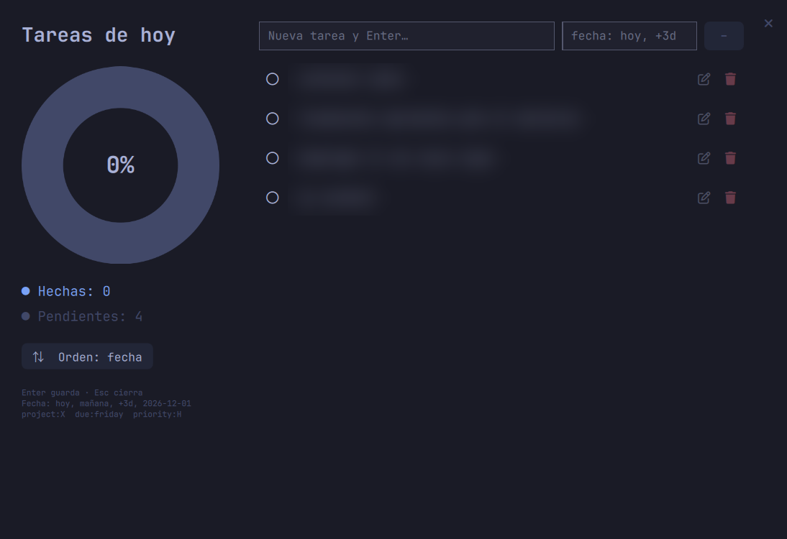
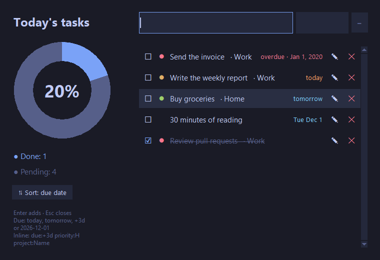

<div align="center">


# Taskline

**Your day, as one line.** A tiny progress bar that shows how many of today's tasks you have finished — right in your Omarchy bar or floating on your Windows desktop.

[](https://github.com/DanielPuertaBernal/taskline/releases/latest)
[](https://github.com/DanielPuertaBernal/taskline/releases)
[](https://github.com/DanielPuertaBernal/taskline/actions/workflows/ci.yml)
[](LICENSE)


[**Install on Omarchy**](#-install-on-omarchy) · [**Download for Windows**](https://github.com/DanielPuertaBernal/taskline/releases/latest/download/taskline.exe) · [Screenshots](#-screenshots) · [FAQ](#-faq)

<br>


</div>

---

## ✨ Why Taskline

| | |
|---|---|
| 📊 **Progress at a glance** | `▰▰▰▱▱▱▱▱▱▱ 1/4` — tasks completed today against everything still open. No app to open, no dashboard to check. |
| ⚡ **One click to manage** | Click the bar to open a panel: add, complete, edit or delete tasks and see today's progress as a donut. |
| 📅 **Due dates & priorities** | Give a task a due date (`today`, `tomorrow`, `+3d`, `2026-12-01`) and a priority (H / M / L). Overdue dates turn red, today's orange. Sort by due date or by priority. |
| 🔄 **Updates itself** | On launch (once a day) Taskline checks for a new release, verifies its SHA256 checksum and installs it. You can turn it off. |
| 🌙 **Tokyo Night look** | Matches the default Omarchy theme on Linux, and brings the same style to Windows. |
| 🐧 **Built on Taskwarrior** | On Omarchy it reads and writes your real [Taskwarrior 3](https://taskwarrior.org) data, and refreshes instantly through a Taskwarrior hook. |
| 🪟 **Native-feeling on Windows** | A borderless, always-on-top bar, a tray icon and an optional *Start with Windows* switch, in a single `.exe`. |
| 🔁 **Portable data** | The Windows app stores tasks in the `task export` JSON format and can import/export Taskwarrior files. |
| 🔒 **Local only** | No accounts, no cloud, no telemetry. Your tasks never leave your machine. |

> **Already on v1.0?** Install v1.1.0 once by hand — see [Upgrading from v1.0](#-upgrading-from-v10). After that, updates install themselves.

## 🐧 Install on Omarchy

**One line:**

```bash
curl -fsSL https://raw.githubusercontent.com/DanielPuertaBernal/taskline/main/install.sh | bash
```

**Or from a release:** download [`taskline-omarchy.tar.gz`](https://github.com/DanielPuertaBernal/taskline/releases/latest/download/taskline-omarchy.tar.gz), then:

```bash
tar -xzf taskline-omarchy.tar.gz && ./taskline-omarchy/install.sh
```

You need Taskwarrior 3 (`omarchy pkg add task`). Then try it:

```bash
task add Write the weekly report due:tomorrow priority:H
task 1 done
```

In the panel, type the task, optionally a date in the **fecha** field (`hoy`, `mañana`, `+3d`, `2026-12-01`, or anything Taskwarrior understands such as `friday`) and click **–** to cycle the priority H → M → L. **Orden** switches between sorting by date and by priority; the choice is remembered. Editing a task shows `due:` and `priority:` in the text — delete them to clear the date or priority.

<details>
<summary>What the installer does</summary>

| Step | Detail |
|---|---|
| Plugin | Copies `danso.tasks` to `~/.config/omarchy/plugins/danso.tasks` (a different existing copy is moved to `*.bak.taskline.<timestamp>`). |
| Taskwarrior hook | Installs `on-exit.omarchy-bar` into the `hooks.location` from your taskrc (`~/.taskrc` or `~/.config/task/taskrc`). Adds `hooks.location` only if it is missing. |
| Bar widget | Adds `danso.tasks` to the `right` section of `~/.config/omarchy/shell.json` (set `TASKLINE_SECTION` to change it), after backing the file up. |
| Floating panel | Adds a Hyprland rule so the task panel floats like Omarchy's floating terminal (only if `~/.config/hypr/hyprland.lua` exists and has no rule yet). |
| Backups | A replaced plugin folder or hook is kept in `~/.local/state/taskline/backups` (last five plugin copies). Edited config files get a `*.bak.taskline.<timestamp>` copy next to them. |
| Reload | On an upgrade it restarts the Omarchy shell so the new panel code loads (a plugin rescan alone keeps the old code running). |

It is idempotent — run it again any time to update — and it never touches your Taskwarrior data.

</details>

## 🪟 Install on Windows

1. Download [**taskline.exe**](https://github.com/DanielPuertaBernal/taskline/releases/latest/download/taskline.exe) from the latest release.
2. Run it. The bar appears at the top of your screen and an icon appears in the tray.
3. Right-click the bar or the tray icon → **Start with Windows** to launch it at login.

| Action | How |
|---|---|
| Open the task panel | Click the bar, or click the tray icon |
| Move the bar | Drag it (the position is remembered) |
| Menu | Right-click the bar: Start with Windows, import/export Taskwarrior JSON, reset position, quit |
| Add a task | Type in the panel and press Enter (`project:Name` groups it) |
| Due date | Type `today`, `tomorrow`, `+3d`, `+2w` or `2026-12-01` in the **due** field, or `due:+3d` in the text |
| Priority | Click **–** next to the due field to cycle H → M → L, or type `priority:H` |
| Sort | **Sort: due date** / **Sort: priority** in the panel (remembered) |
| Complete / edit / delete | ☐ / ✎ (or double-click) / ✕ on each row |
| Updates | Right-click → **Update automatically** (on by default) or **Check for updates now**; **About Taskline** shows the version |

Tasks live in `%APPDATA%\taskline\tasks.json`. Windows SmartScreen may warn about an unsigned download; choose **More info → Run anyway**. Coming from v1.0? See [Upgrading from v1.0](#-upgrading-from-v10).

## 🔄 Automatic updates

| | Windows | Omarchy |
|---|---|---|
| When | 4 seconds after launch, at most once a day | 15 seconds after the plugin loads, at most once a day |
| What it checks | The latest GitHub release of this repository | Same |
| Verification | Downloads `taskline.exe` and checks its SHA256 against `SHA256SUMS.txt` from the same release. A missing or wrong checksum means nothing is installed. | Same, for `taskline-omarchy.tar.gz` |
| Install | A small helper script waits for Taskline to close, renames the current exe to `taskline.exe.bak`, puts the new one in place (restoring the backup if that fails) and starts Taskline again, which shows **Updated to vX.Y.Z**. | Runs the release's `install.sh` (backs up, idempotent), restarts the shell and sends a notification. Log: `~/.local/state/taskline/update.log`. |
| Offline / rate limited | Silently skipped | Silently skipped, retried on the next load |
| Turn it off | Right-click the bar → uncheck **Update automatically** | `echo auto_update=false > ~/.config/taskline/omarchy.conf` |
| Update by hand | Right-click → **Check for updates now** | `~/.config/omarchy/plugins/danso.tasks/taskline-update` |

## ⬆️ Upgrading from v1.0

v1.0 has no updater, so install v1.1 once by hand. From then on updates arrive by themselves.

**Windows**

1. Quit Taskline: right-click the tray icon → **Quit**, so Windows lets you replace the file.
2. Download **taskline.exe** from the [latest release](https://github.com/DanielPuertaBernal/taskline/releases/latest).
3. Replace the old exe **in the same folder, with the same name**. The **Start with Windows** option stores that exact path in the `Run` registry key; a copy somewhere else would leave Windows starting the old one, or nothing.
4. Open it. SmartScreen may warn because the exe is unsigned: **More info → Run anyway**.
5. Done. Your tasks stay in `%APPDATA%\taskline`; the file is backed up before it is migrated, and from now on updates install automatically on launch.

**Omarchy** — run the one-line installer again:

```bash
curl -fsSL https://raw.githubusercontent.com/DanielPuertaBernal/taskline/main/install.sh | bash
```

It backs up the plugin, hook and config it changes and never touches your Taskwarrior data. Afterwards updates are automatic.

## 🛡️ Your tasks are safe

Updates replace the program, never your tasks.

**Windows**

- Tasks live in `%APPDATA%\taskline\tasks.json`, never in the folder of the exe. The updater only replaces `taskline.exe`.
- `tasks.json` stays a plain `task export` array, so older versions and Taskwarrior can still read it. Its schema version is kept beside it in `tasks.meta.json`.
- Before a new version changes the file's schema, it copies the original to `tasks.json.bak-<old version>-<date>` (the last five are kept).
- Every save writes a temporary file, flushes it to disk and then renames it over the old one, so a crash or power cut mid-write leaves the previous file intact.
- If the file cannot be read or migrated, Taskline leaves it untouched and opens **read-only** with a message explaining why — it never overwrites a file it did not understand.
- Rolling back: the updater keeps the previous exe as `taskline.exe.bak` next to the new one. v1.0 reads a v1.1 `tasks.json` fine (it keeps the new `due` and `priority` fields).

**Omarchy**

- Tasks live in Taskwarrior's own data folder (`data.location`, usually `~/.local/share/task`). Neither `install.sh` nor the updater ever writes there.
- An update replaces only the plugin files and the hook, after backing them up to `~/.local/state/taskline/backups`.

## 📸 Screenshots

| Omarchy — bar widget | Omarchy — task panel |
|---|---|
|  |  |

| Windows — bar | Windows — task panel |
|---|---|
|  |  |

<sub>Omarchy screenshots are from a real desktop, with the owner's task names blurred. Windows screenshots are captured automatically by CI on `windows-latest` from the built `taskline.exe`, using demo tasks with due dates (overdue in red, today in orange) and priority markers.</sub>

## 🛠️ Build from source

**Omarchy package** (what the release ships):

```bash
bash tests/install_test.sh        # installer tests in a temporary HOME
bash tests/update_test.sh         # auto-update against a fake release
node tests/logic_test.js          # panel logic: due dates, priority, sorting
scripts/package-omarchy.sh        # -> dist/taskline-omarchy.tar.gz
```

**Windows app** (Python 3.10+, Tkinter, pystray, Pillow, PyInstaller):

```powershell
cd windows
./build.ps1                       # -> windows/dist/taskline.exe
./selftest.ps1                    # drives the real UI and checks the result
```

Run it without building, on any OS with Tk: `cd windows && pip install pystray pillow && python -m taskline`. Tests: `cd windows && pip install pytest && python -m pytest`.

Releases are automatic: pushing a `v*` tag (it must match the version in the code) builds `taskline.exe` on Windows and the Omarchy tarball on Linux, and attaches both plus `SHA256SUMS.txt` to a GitHub Release — the file the updaters verify against.

## 🧹 Uninstall

**Omarchy:**

```bash
curl -fsSL https://raw.githubusercontent.com/DanielPuertaBernal/taskline/main/uninstall.sh | bash
```

This removes the plugin, the hook, the bar entry and the window rule (backing up edited files). Your tasks and taskrc are kept.

**Windows:** right-click the bar → turn off **Start with Windows** → **Quit**, then delete `taskline.exe`. To also delete your tasks, remove `%APPDATA%\taskline`.

## ❓ FAQ

<details>
<summary><b>What does "1/4" count exactly?</b></summary>

Tasks completed **today** over today's completed plus every task still **pending**. Tomorrow the count starts fresh; tasks you finished yesterday no longer count.
</details>

<details>
<summary><b>Does the Windows app need Taskwarrior?</b></summary>

No. Taskwarrior is not native on Windows, so the app keeps its own file in the same format as `task export`. Use **Import/Export Taskwarrior JSON** from the bar menu to move tasks between machines.
</details>

<details>
<summary><b>The Omarchy widget does not show up.</b></summary>

The widget hides itself while there are no tasks for today. Add one with `task add …`. If it is still missing, run `omarchy-shell shell rescanPlugins` and check that `task --version` prints 3.x.
</details>

<details>
<summary><b>Is anything sent over the network?</b></summary>

Nothing about you or your tasks. The only network access is downloading releases: the installer when you run it through `curl`, and the once-a-day update check against the GitHub Releases API (turn it off as shown in [Automatic updates](#-automatic-updates)).
</details>

## 🗺️ Roadmap

- [ ] Code-signed Windows build
- [ ] Translations for the Omarchy panel (it is in Spanish today)
- [ ] Optional sync with a Taskwarrior server
- [ ] macOS menu bar version

Ideas and bug reports are welcome in [Issues](https://github.com/DanielPuertaBernal/taskline/issues).

---

<div align="center">

Created by **[Daniel Puerta](https://github.com/DanielPuertaBernal)** · [danielpuertabernal.github.io](https://danielpuertabernal.github.io)

Released under the [MIT License](LICENSE) · © 2026 Daniel Puerta

</div>
